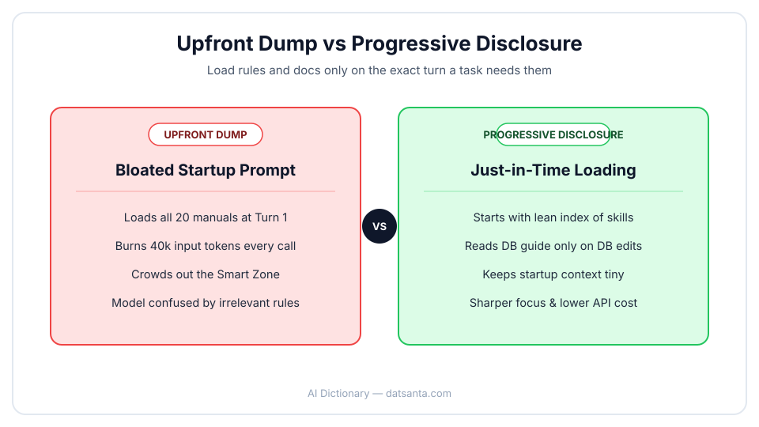

# Progressive Disclosure

**Progressive disclosure** is loading instructions, tool definitions, or codebase documentation into an agent's context *only when the current task needs them*, instead of dumping every rule and manual into the [system prompt](system-prompt.md) upfront.

## Everyday example

A good restaurant menu lists section headers first rather than printing every recipe's full ingredient list on page one. In coding agents, progressive disclosure keeps startup context lean: the [harness](harness.md) gives the agent a short index of available [skills](skill.md) and file paths, and the agent only opens `DATABASE_MIGRATIONS.md` on the exact turn it actually touches the database—preserving the [smart zone](smart-zone.md) and cutting input token costs.

## Don't confuse with

- **[Compaction](compaction.md):** Compaction cleans up clutter *after* the context window fills up; progressive disclosure prevents clutter from entering the context window in the first place.

## Related terms

- [Skill](skill.md)
- [AGENTS.md](agents-md.md)
- [Smart Zone](smart-zone.md)
