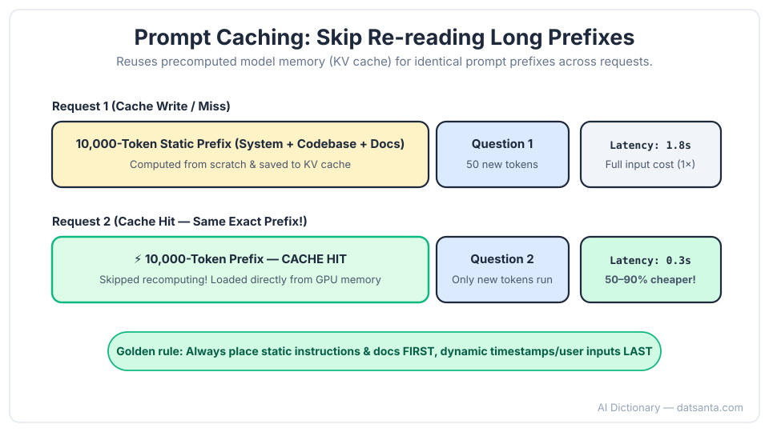

# Prompt Caching

**Prompt caching** stores and reuses the precomputed internal GPU states (`KV cache`) of a long, repeated prompt prefix across API calls, cutting both cost and Time-To-First-Token latency dramatically.

## Everyday example

Suppose your coding assistant sends a 10,000-[token](token.md) [system prompt](system-prompt.md) plus repository docs on every message. Without caching, the model re-reads all 10,000 tokens from scratch each turn.

With prompt caching enabled, the first call computes and caches that prefix; subsequent calls reuse it straight from memory — running up to 80% faster and 50–90% cheaper on cached input tokens.

## Don't confuse with

- **Semantic response caching (Redis):** Response caching returns the exact same saved final answer for similar questions; prompt caching still runs fresh generation on the *new* suffix while skipping prefix recomputation.
- **Dynamic prefix ordering:** Putting a changing timestamp or user ID on line 1 breaks the cache on every single call — always put static instructions and docs first.

## Related terms

- [System Prompt](system-prompt.md)
- [Context Window](context-window.md)
- [Latency vs. Throughput](latency-vs-throughput.md)
- [Inference](inference.md)
