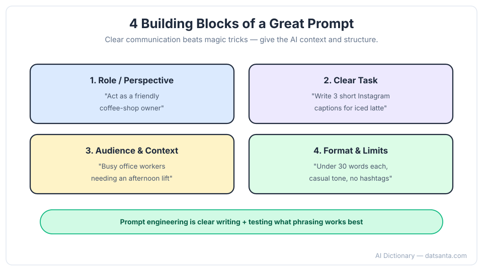

# Prompt Engineering

**Prompt engineering** is the practical skill of writing clear, structured instructions so an AI consistently gives accurate, useful answers instead of vague guesses.

## Everyday example

Two people can use the exact same AI tool and get wildly different results. One types *"Help me with marketing"* and gets generic fluff. The other gives a clear role, audience, goal, and format: *"Act as a coffee-shop owner. Write 3 short Instagram captions for busy office workers under 30 words each."*

Despite the fancy name, prompt engineering is mostly clear communication and testing what phrasing works best.

## Don't confuse with

- **Coding / Software engineering:** You do not need to know how to code to practice prompt engineering; plain, clear writing is the main skill.
- **[Fine-tuning](fine-tuning.md):** Prompt engineering guides an existing model using better instructions; fine-tuning retrains the model itself on new data.

## Related terms

- [Prompt](prompt.md)
- [Few-shot Prompting](few-shot-prompting.md)
- [Zero-shot](zero-shot.md)
- [System Prompt](system-prompt.md)
