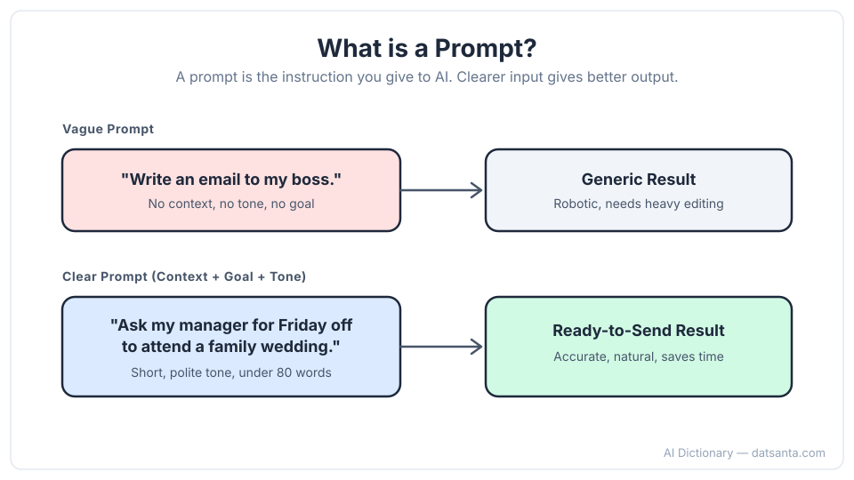

# Prompt

A **prompt** is the instruction, question, or context you type into an AI tool to tell it what you want. The clearer your prompt is, the more useful the AI's answer will be.

## Everyday example

Talking to AI is like briefing a new assistant. If you say *"Write an email,"* you will get something vague and robotic. If you say *"Write a polite, 3-sentence email asking my manager for Friday off to attend a family wedding,"* you get a draft you can send right away.

Good prompts usually share three things: what you want done, who it is for, and the tone or format you expect.

## Don't confuse with

- **[Context window](context-window.md):** The prompt is your current message; the context window is the total space available for your prompt, uploaded files, and the whole conversation.
- **Search query:** Google looks for existing web pages matching your keywords; a prompt tells AI what to create or analyze for you.

## Related terms

- [LLM](llm.md)
- [Context window](context-window.md)
- [Token](token.md)
