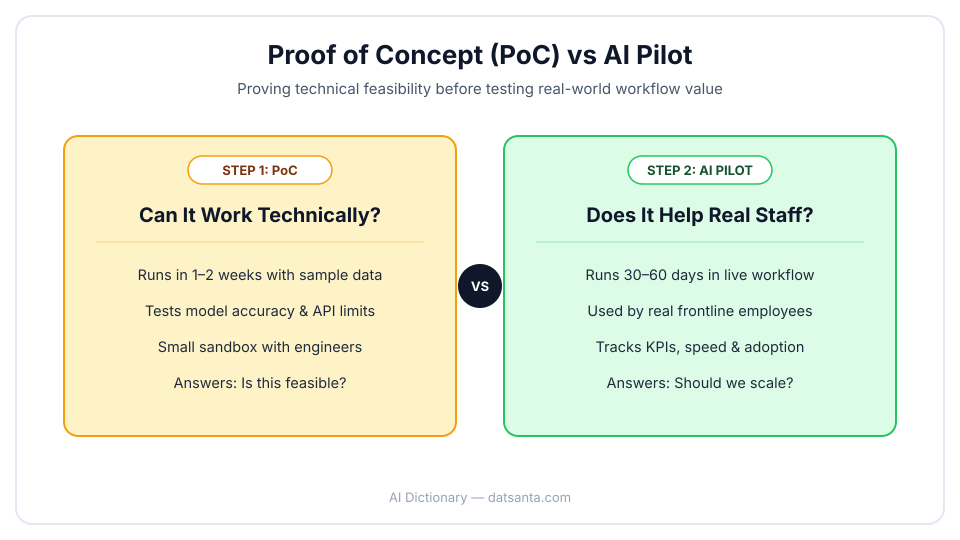

# Proof of Concept (POC)

A **Proof of Concept (POC)** is a quick, low-budget experiment — usually lasting 1 to 3 weeks — built solely to prove whether an AI idea actually works on your real company data before spending big money.

## Everyday example

Before opening a full restaurant, a chef tests three signature dishes at a weekend pop-up booth to see if customers actually like the taste and if the kitchen timing works.

In business AI, a POC tests whether a model can extract invoice numbers accurately from 50 real PDFs or answer 30 real customer questions using [RAG](rag.md). If accuracy fails in the POC, you save months of wasted engineering.

## Don't confuse with

- **[AI pilot](ai-pilot.md):** A POC proves technical *feasibility* in a small test; a pilot puts a working version into the hands of real staff or customers in daily operations.
- **Public vendor demo:** A vendor's polished demo uses clean sample files; your POC must run on your own messy, real-world documents.

## Related terms

- [AI Pilot](ai-pilot.md)
- [AI ROI](ai-roi.md)
- [Build vs. Buy](build-vs-buy.md)
- [Evals](evals.md)
