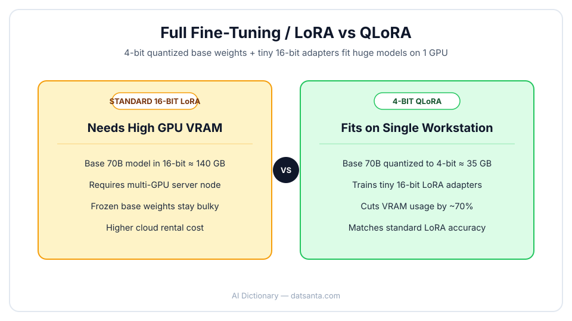

# QLoRA (Quantized LoRA)

**QLoRA** combines 4-bit [quantization](quantization.md) of a frozen base model with small trainable [LoRA](lora.md) adapters, letting developers fine-tune large models on a single consumer or mid-range GPU.

## Everyday example

Renovating a massive historic building does not require tearing down and rebuilding every load-bearing brick wall. You lock the heavy structure in compressed storage and only remodel the lightweight interior partitions. By keeping the base weights quantized in 4-bit while training tiny 16-bit adapter matrices, QLoRA slashes fine-tuning [VRAM](vram.md) requirements by roughly 70% with almost no loss in quality.

## Don't confuse with

- **[LoRA](lora.md):** Standard LoRA keeps the frozen base model in 16-bit precision; QLoRA quantizes that frozen base model to 4-bit so much bigger models fit into limited GPU memory.

## Related terms

- [LoRA](lora.md)
- [Quantization](quantization.md)
- [VRAM](vram.md)
