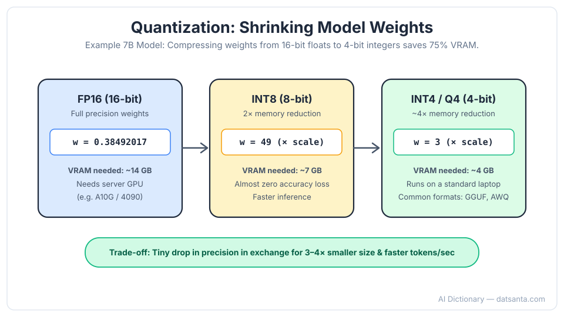

# Quantization

**Quantization** shrinks an AI model's stored weights from high-precision numbers (like 16-bit floats) down to compact integers (8-bit or 4-bit), slashing memory usage and boosting [inference](inference.md) speed.

## Everyday example

Think of saving a crisp RAW camera photo as a high-quality JPEG. Instead of storing ultra-precise decimals like `0.38492017` for every single parameter, quantization rounds weights onto a smaller grid of 4-bit or 8-bit integers.

A 7-billion-parameter model that requires ~14 GB of GPU VRAM in FP16 drops to ~4 GB in 4-bit (`Q4` / `AWQ`), letting you run capable local models smoothly on a standard laptop.

## Don't confuse with

- **Distillation:** Distillation trains a brand-new smaller student model from a larger teacher; quantization keeps the exact same model architecture and just compresses its number precision.
- **Pruning:** Pruning deletes less useful neural connections entirely; quantization keeps all weights but stores each one in fewer bits.

## Related terms

- [Inference](inference.md)
- [LoRA](lora.md)
- [Latency vs. Throughput](latency-vs-throughput.md)
