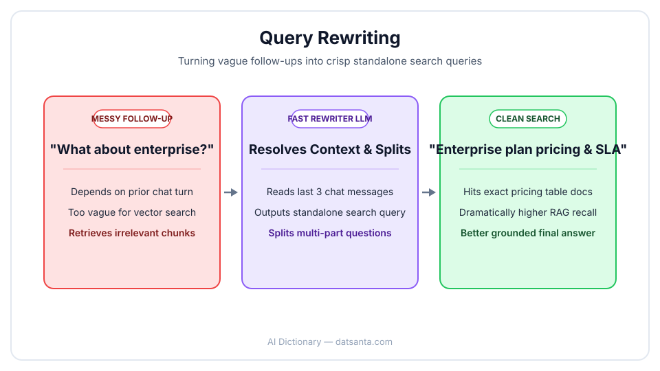

# Query Rewriting

**Query rewriting** uses a fast LLM step before retrieval to turn a messy, ambiguous, or follow-up user message into clean, standalone search queries that retrieve far better [RAG](rag.md) documents.

## Everyday example

In a multi-turn chat, a user asks, `"What about enterprise?"` right after asking about Starter pricing. Searching a vector database literally for `"What about enterprise?"` returns random noise. A query rewriter expands it into `"Enterprise plan pricing, limits, and SLA features"` (and can split compound questions into sub-queries) so the retriever hits the exact right docs.

## Don't confuse with

- **[HyDE](hyde.md):** Query rewriting cleans up or expands the *question* itself; HyDE generates a *hypothetical answer* paragraph and searches with the answer's embedding.

## Related terms

- [HyDE](hyde.md)
- [RAG](rag.md)
- [Agentic RAG](agentic-rag.md)
