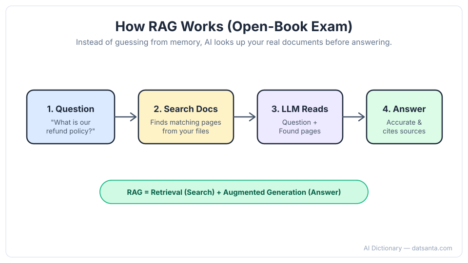

# RAG (Retrieval-Augmented Generation)

**RAG** is a technique that lets an AI search your real documents before answering a question. Instead of relying only on its memory, it looks up the right facts first and writes an answer based on them.

## Everyday example

Think of a closed-book exam versus an open-book exam. A regular [LLM](llm.md) takes a closed-book exam: if it forgot your company's refund policy, it might guess and [hallucinate](hallucination.md).

RAG gives the AI an open-book exam. When you ask a question, the system first finds the exact paragraphs in your company handbook or PDFs, hands them to the AI, and says: *"Answer using only these pages."*

## Don't confuse with

- **[Fine-tuning](fine-tuning.md):** Fine-tuning teaches AI a new style or skill by retraining it; RAG leaves the model unchanged and just hands it fresh documents at question time.
- **Web search:** Search gives you a list of links to read yourself; RAG reads the matching pages and writes a direct answer for you.

## Related terms

- [Hallucination](hallucination.md)
- [Context window](context-window.md)
- [Fine-tuning](fine-tuning.md)
- [LLM](llm.md)
