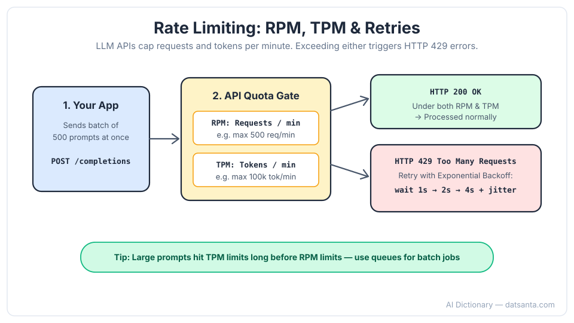

# Rate Limiting

**Rate limiting** is the cap an AI API enforces on how many requests per minute (`RPM`) and [tokens](token.md) per minute (`TPM`) your app can send before returning `HTTP 429 Too Many Requests`.

## Everyday example

Think of a highway tollbooth with two limits: maximum cars per minute (`RPM`) and maximum total weight per minute (`TPM`). Send 50 giant 20,000-token prompts at once and you will blow past your `TPM` quota long before hitting `RPM`.

Reliable code handles `429` errors with **exponential backoff and jitter** (waiting `1s → 2s → 4s` plus random milliseconds) or moves bulk jobs into a background queue.

## Don't confuse with

- **Spending budget cap:** A monthly billing limit stops your credit card permanently once spent; rate limits throttle bursts per second or minute and reset right away.
- **[Context window](context-window.md):** Context window is the max tokens in *one* call; `TPM` is the total tokens allowed across *all* concurrent calls in 60 seconds.

## Related terms

- [Token](token.md)
- [Latency vs. Throughput](latency-vs-throughput.md)
- [Orchestration](orchestration.md)
- [Prompt Caching](prompt-caching.md)
