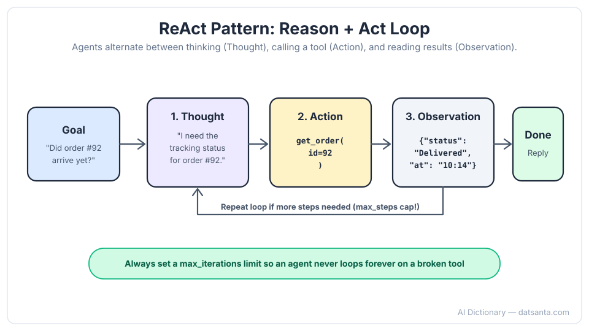

# ReAct Pattern

The **ReAct pattern** (Reason + Act) structures an [AI agent](ai-agent.md) as a loop alternating between **Thought** (planning the next step), **Action** (calling a tool), and **Observation** (reading the tool's output).

## Everyday example

Think of debugging a production bug. You do not guess the fix blindly on line 1 — you think (*"Let's check the error logs"*), act (`tail -n 50 app.log`), observe (`NullPointerException on line 42`), then think again before fixing it.

In code, a ReAct loop feeds each `Observation` back into the [context window](context-window.md) until the task is finished — always enforcing a `max_iterations` cap so broken tools never loop forever.

## Don't confuse with

- **[Chain of thought](chain-of-thought.md):** Chain of thought reasons purely inside text without calling external tools or receiving real-world feedback.
- **Fixed workflow:** A workflow follows predetermined `if/else` steps; a ReAct agent decides dynamically which tool to call next based on what it just observed.

## Related terms

- [AI Agent](ai-agent.md)
- [Function Calling](function-calling.md)
- [Chain of Thought](chain-of-thought.md)
- [Orchestration](orchestration.md)
