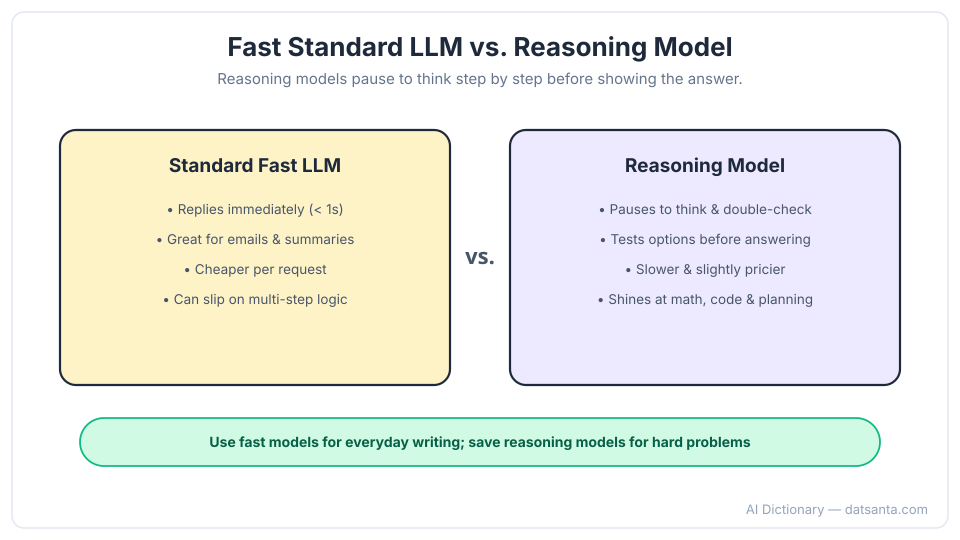

# Reasoning Model

A **reasoning model** is an AI designed to pause and work through tough problems step by step — checking its own logic before showing you the final answer.

## Everyday example

Think of the difference between answering *"What's 2 + 2?"* instantly from reflex versus sitting down with scratch paper to plan a 5-day budget trip or solve a tricky logic puzzle.

Standard [LLMs](llm.md) start replying immediately, which is great for quick writing and summaries. A reasoning model spends a few extra seconds thinking through options and catching its own mistakes — making it far stronger at math, coding, and complex planning.

## Don't confuse with

- **Standard fast [LLM](llm.md):** Fast models reply in under a second and cost less for everyday tasks; reasoning models take longer and cost more, so save them for hard problems.
- **[Chain of thought](chain-of-thought.md):** Chain of thought is a prompting trick *you* ask for; a reasoning model is trained specifically to think step by step automatically.

## Related terms

- [Chain of Thought](chain-of-thought.md)
- [LLM](llm.md)
- [Hallucination](hallucination.md)
- [AI Agent](ai-agent.md)
