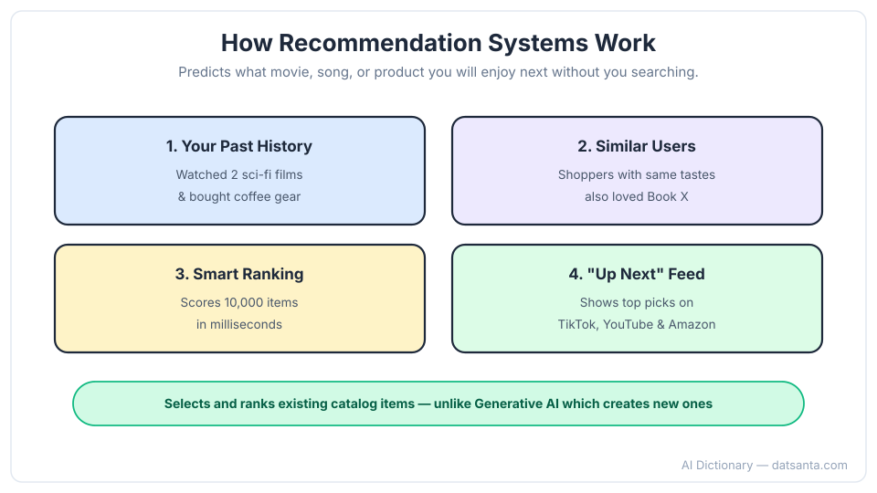

# Recommendation System

A **recommendation system** is an AI engine that predicts what movies, songs, products, or posts you are most likely to enjoy next — based on your past behavior and people with similar tastes.

## Everyday example

Think of a sharp bookstore clerk who notices you bought two sci-fi novels and three coffee-brewing guides, sees that other shoppers with those exact books loved a specific new thriller, and puts it on your counter.

TikTok's "For You" feed, Amazon's *"Customers also bought,"* and YouTube's "Up Next" sidebar are all powered by recommendation systems working silently in real time.

## Don't confuse with

- **Search engine:** Search waits for you to type what you want; a recommendation system proactively guesses what might catch your interest without you asking.
- **[Generative AI](generative-ai.md):** Recommendation systems pick and rank *existing* items from a catalog rather than inventing brand-new videos or products from scratch.

## Related terms

- [Personalization](personalization.md)
- [Machine Learning](machine-learning.md)
- [Algorithm](algorithm.md)
