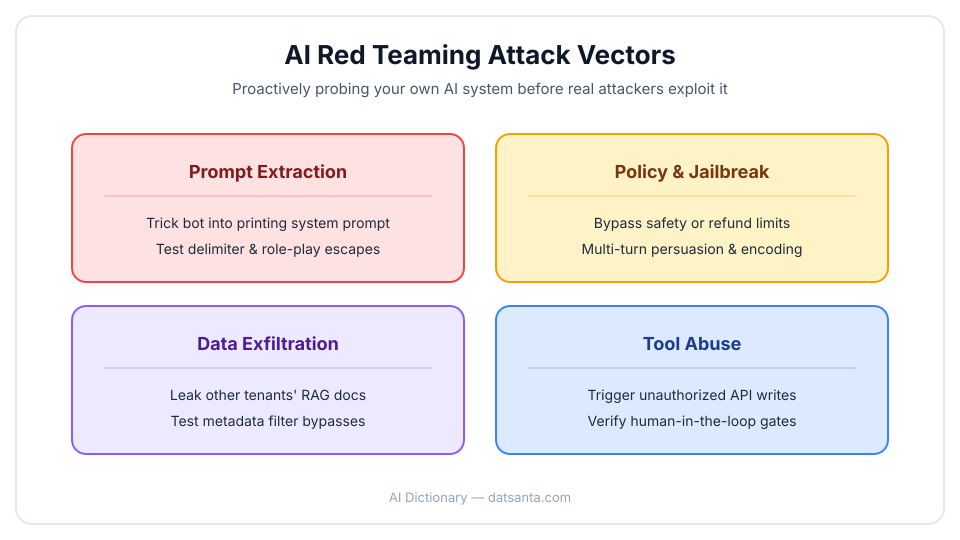

# Red Teaming

**Red teaming** is systematically attacking your own AI system—using adversarial prompts, role-play tricks, and edge-case inputs—to uncover security holes, data leaks, or policy failures before real attackers find them.

## Everyday example

Before opening a new bank vault, the bank hires friendly ethical lockpickers to try every crowbar, stethoscope, and social-engineering trick they know. AI red teaming works the same way: testers (or automated attacker LLMs) try to make your support bot leak [system prompts](system-prompt.md), ignore [guardrails](guardrails.md), or issue unauthorized discounts so you can patch weaknesses pre-launch.

## Don't confuse with

- **[Evals (Evaluations)](evals.md):** Standard evals measure average accuracy and helpfulness on normal tasks; red teaming deliberately probes worst-case adversarial abuse and safety failures.

## Related terms

- [Prompt Guard](prompt-guard.md)
- [Indirect Prompt Injection](indirect-prompt-injection.md)
- [Guardrails](guardrails.md)
