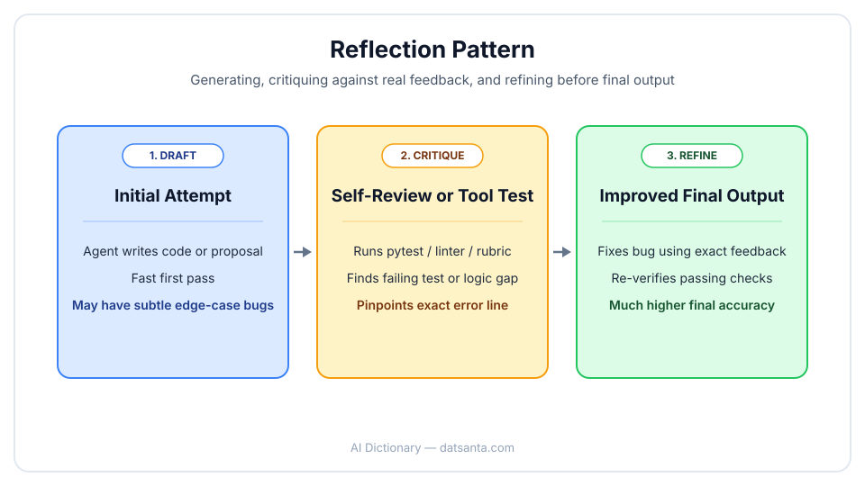

# Reflection Pattern

The **reflection pattern** is an agent design where the model critiques its own draft output (or receives automated test/linter feedback) and revises it over one or more loops before returning the final answer.

## Everyday example

Good writers never hit Send on the very first draft of an important proposal; they step back, read it critically for missing logic or awkward phrasing, and polish a second draft. In coding agents, writing a function, running `pytest`, reading the traceback, and fixing the bug in a second pass routinely doubles pass rates compared to single-shot generation.

## Don't confuse with

- **[Chain of Thought](chain-of-thought.md):** Chain of thought thinks step by step *before* committing to an answer in one pass; reflection critiques and improves an *already generated* draft across iterations.

## Related terms

- [Planning Pattern](planning-pattern.md)
- [ReAct Pattern](react-pattern.md)
- [LLM-as-a-Judge](llm-as-a-judge.md)
