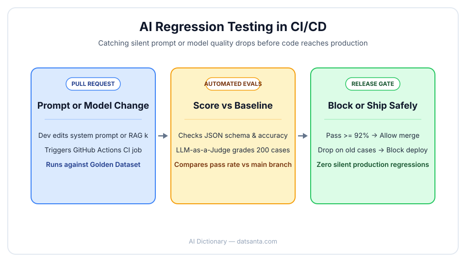

# AI Regression Testing

**AI regression testing** automatically runs your [evals](evals.md) suite against a [golden dataset](golden-dataset.md) in CI/CD before every prompt, model, or retrieval change deploys—catching silent quality drops before users do.

## Everyday example

Fixing a rattle in a car door should not accidentally disconnect the brake lights. When developers edit a [system prompt](system-prompt.md) to fix one edge-case complaint, they often unknowingly break three older behaviors. Running automated regression tests on every pull request blocks any prompt or model upgrade whose pass rate drops below your release threshold.

## Don't confuse with

- **[Post-Deployment Monitoring](post-deployment-monitoring.md):** Regression testing runs *before* shipping code on a fixed test suite; post-deployment monitoring watches *live* production traffic after release.

## Related terms

- [Golden Dataset](golden-dataset.md)
- [Evals (Evaluations)](evals.md)
- [Post-Deployment Monitoring](post-deployment-monitoring.md)
