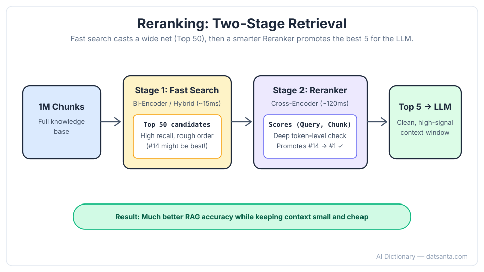

# Reranking

**Reranking** is a second-stage scoring step in [RAG](rag.md) where a specialized Cross-Encoder model reads your query alongside each top candidate chunk together and re-orders the very best results to the top.

## Everyday example

Think of hiring for a role. Stage 1 (fast [vector search](vector-database.md) or [hybrid search](hybrid-search.md)) scans 10,000 resumes in 15ms and pulls the top 50 rough matches.

Stage 2 (the Reranker) sits down and carefully reads each of those 50 resumes side-by-side against the job description, promoting the true `#1` match from position `#14` up to `#1` before handing just the top 5 to your [LLM](llm.md).

## Don't confuse with

- **Initial retrieval (Bi-Encoder):** Vector search embeds query and documents separately for speed; a Reranker processes `(query, chunk)` pairs together, making it slower but far more accurate.
- **Putting all 50 chunks into the prompt:** Stuffing 50 chunks wastes [tokens](token.md), adds latency, and triggers "lost in the middle" misses inside the [context window](context-window.md).

## Related terms

- [Hybrid Search](hybrid-search.md)
- [RAG](rag.md)
- [Vector Database](vector-database.md)
- [Context Window](context-window.md)
