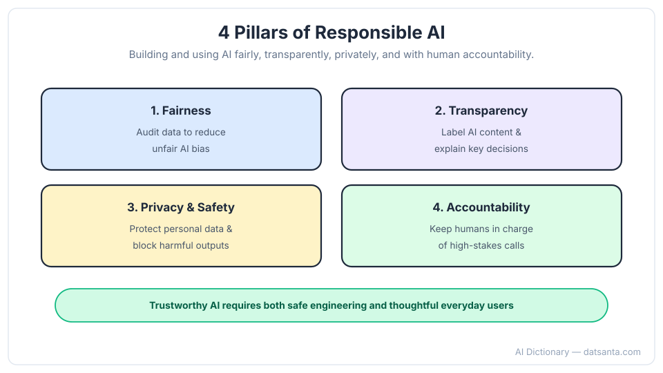

# Responsible AI

**Responsible AI** is the practice of designing, building, and using AI systems in ways that are fair, transparent, safe, privacy-respecting, and accountable to real people.

## Everyday example

Just as food makers must list ingredients, follow hygiene rules, and recall unsafe batches, teams building AI need clear safety habits too — checking for [AI bias](ai-bias.md), labeling AI-generated media, protecting personal data, and keeping humans accountable for high-stakes calls.

For everyday users, responsible AI simply means using AI honestly, respecting privacy, and never blindly trusting automated answers in medical, legal, or financial decisions.

## Don't confuse with

- **Slowing down innovation:** Good safety practices build long-term user trust so people actually feel comfortable adopting AI at work and in daily life.
- **[AI alignment](ai-alignment.md):** AI alignment is the technical research of steering model behavior; responsible AI is the broader human, ethical, legal, and organizational commitment around how AI is used.

## Related terms

- [AI Alignment](ai-alignment.md)
- [AI Bias](ai-bias.md)
- [AI Governance](ai-governance.md)
- [AI Literacy](ai-literacy.md)
