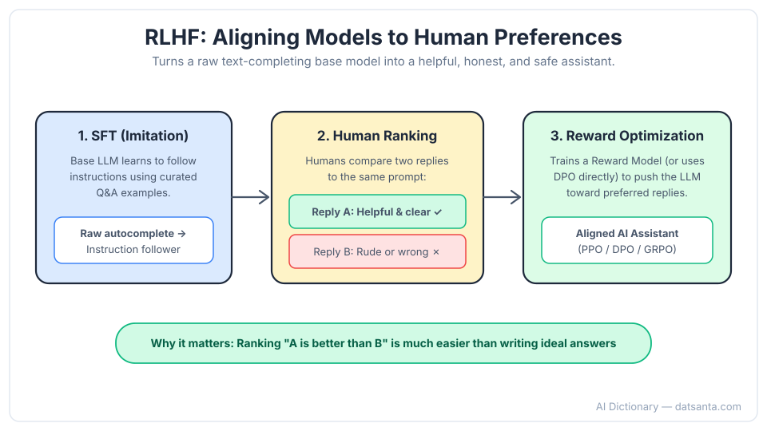

# RLHF (Reinforcement Learning from Human Feedback)

**RLHF** is the alignment stage after pretraining where models learn from human preference rankings (`Reply A > Reply B`) to behave like helpful, honest, and safe assistants rather than raw text predictors.

## Everyday example

A raw pretrained [LLM](llm.md) only knows how to autocomplete internet text — ask it a question, and it might output five more questions instead of answering.

First, supervised fine-tuning (`SFT`) shows it Q&A examples. Next, human reviewers rank pairs of candidate answers (`A` is clear and polite ✓; `B` is rude ✗). Optimization algorithms (`PPO` or `DPO`) then nudge model weights toward human-preferred answers.

## Don't confuse with

- **Pretraining:** Pretraining teaches grammar, facts, and coding on trillions of tokens; RLHF shapes tone, refusal boundaries, and instruction-following behavior afterward.
- **[Fine-tuning](fine-tuning.md) (SFT):** SFT imitates single "gold" demonstrations; RLHF learns from relative comparisons between good and bad outputs.

## Related terms

- [Fine-tuning](fine-tuning.md)
- [LoRA](lora.md)
- [LLM](llm.md)
- [Guardrails](guardrails.md)
