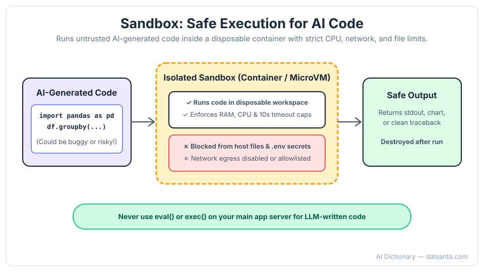

# Sandbox

A **sandbox** is an isolated, disposable execution environment (such as a container or microVM) where untrusted AI-generated code or [agent](ai-agent.md) shell commands run safely without risking your host server or secrets.

## Everyday example

Letting an LLM write Python or Bash scripts and running `exec()` directly on your production backend is like handing a stranger keys to your database and `.env` file.

A sandbox puts that code inside a locked concrete testing room with strict CPU/RAM caps, a 10-second timeout, blocked host filesystem access, and disabled network egress — returning `stdout` or tracebacks cleanly before destroying the container.

## Don't confuse with

- **Python `try/except` block:** Catching exceptions in your main process still shares your server's memory, filesystem, and environment variables with malicious or buggy code.
- **[Guardrails](guardrails.md):** Guardrails filter text going into or out of a model; a sandbox isolates actual OS-level code execution.

## Related terms

- [AI Agent](ai-agent.md)
- [Guardrails](guardrails.md)
- [MCP](mcp.md)
- [Prompt Injection](prompt-injection.md)
