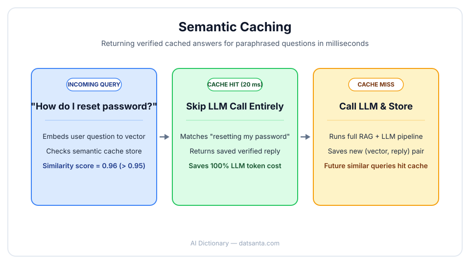

# Semantic Caching

**Semantic caching** stores past LLM responses keyed by the *meaning* (embedding vector) of a query so new questions phrased slightly differently still get an instant cached reply without calling the LLM again.

## Everyday example

A traditional Redis cache only hits when two strings match character-for-character (`"reset password"` vs `"how do I reset my password?"` misses). Semantic caching embeds the incoming question, checks a fast vector store for similarity above e.g. `0.95`, and returns the verified cached answer in 20 ms—cutting API bills and latency dramatically on repetitive support traffic.

## Don't confuse with

- **[Prompt Caching](prompt-caching.md):** Prompt caching reuses a shared *prompt prefix* (like system instructions) inside the LLM provider while still running decode; semantic caching skips the LLM call completely for similar user questions.

## Related terms

- [Embeddings](embeddings.md)
- [Prompt Caching](prompt-caching.md)
- [Cost per Task](cost-per-task.md)
