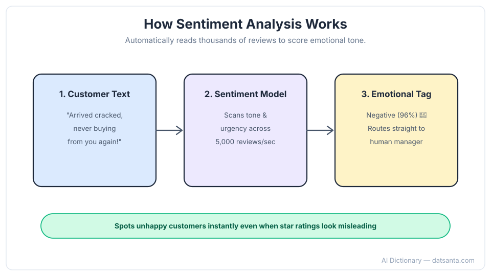

# Sentiment Analysis

**Sentiment analysis** is an AI technique that reads text — such as product reviews, social media posts, or support tickets — and detects the emotional tone behind it: positive, negative, or neutral.

## Everyday example

Suppose an online store receives 5,000 customer reviews after a product launch. Nobody can read all 5,000 in an afternoon.

Sentiment analysis scans every review in seconds, tagging *"Battery lasts all week!"* as Positive, *"Arrived cracked, never buying again"* as Negative (urgent!), and routing angry tickets straight to a human manager first.

## Don't confuse with

- **Star ratings:** A customer might leave 3 stars yet write *"Shipping was awful and box was torn"* — sentiment analysis reads the actual words and feelings, not just numbers.
- **[LLM](llm.md) full summary:** Sentiment analysis focuses specifically on scoring emotional tone; modern LLMs can do sentiment analysis plus explain *why* the customer is upset.

## Related terms

- [NLP](nlp.md)
- [Machine Learning](machine-learning.md)
- [AI Workflow](ai-workflow.md)
