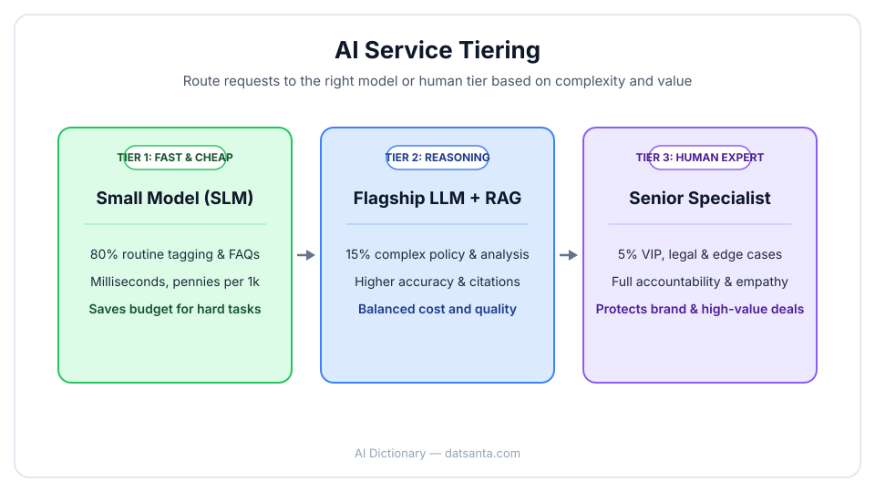

# Service Tiering

**Service tiering** is routing different requests to different AI models—or to human staff—based on task difficulty, urgency, or customer value, instead of using the most expensive option for everything.

## Everyday example

A logistics company does not send every small envelope by private jet. Standard mail goes on a regular truck, urgent contracts go by express air, and fragile equipment gets a dedicated courier. With AI, simple FAQ sorting uses a fast, cheap small model, complex contract analysis goes to a flagship model, and VIP complaints route straight to a senior human specialist.

## Don't confuse with

- **[Cost per Task](cost-per-task.md):** Cost per task measures what one job costs; service tiering is the routing strategy that keeps high-volume tasks cheap while protecting quality on hard ones.

## Related terms

- [Token Budget](token-budget.md)
- [Escalation Path](escalation-path.md)
- [LLM](llm.md)
