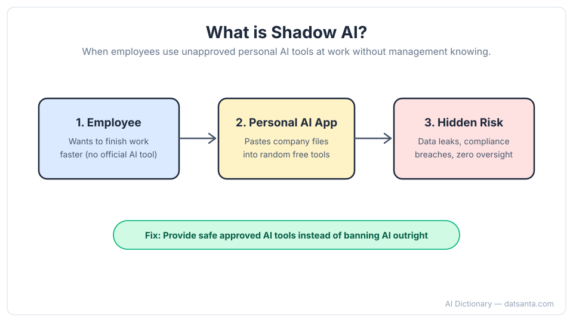

# Shadow AI

**Shadow AI** happens when employees secretly use unapproved personal AI tools at work — often pasting company documents or customer data into free apps without IT or management knowing.

## Everyday example

If a company bans cloud storage without offering an approved option, staff still need to send large files — so they quietly use personal email or random file-sharing sites.

The same happens with AI. Employees want to finish reports or emails faster. If leadership bans AI instead of providing a safe, company-approved tool, staff simply use personal AI accounts on their phones or browsers, creating hidden data-leak risks.

## Don't confuse with

- **Malicious hacking:** Employees using shadow AI are rarely trying to hurt the company; they are usually trying to work faster because official tools are missing or too slow.
- **[AI governance](ai-governance.md):** Governance is the set of clear rules and approved tools designed to prevent shadow AI in the first place.

## Related terms

- [Data Privacy](data-privacy.md)
- [AI Governance](ai-governance.md)
- [Human-in-the-Loop](human-in-the-loop.md)
