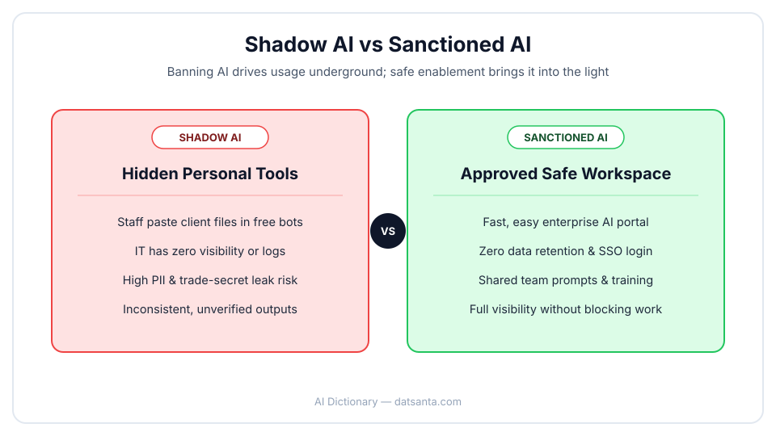

# Shadow IT (Shadow AI)

**Shadow IT (or Shadow AI)** happens when employees use unapproved personal AI tools or browser extensions for work tasks without telling IT, security, or management.

## Everyday example

If the office coffee machine breaks and takes three approvals to replace, staff bring their own kettles and plug them into overloaded power strips. When companies ban AI or take six months to approve a tool, employees quietly open free personal chatbots on their phones and paste meeting notes or client contracts into them. Banning AI without offering a safe alternative almost always creates Shadow AI.

## Don't confuse with

- **[AI Adoption](ai-adoption.md):** AI adoption is sanctioned, visible usage inside approved company workflows; Shadow AI is hidden usage outside company security controls.

## Related terms

- [AI Enablement](ai-enablement.md)
- [Zero Data Retention](zero-data-retention.md)
- [Data Governance](data-governance.md)
