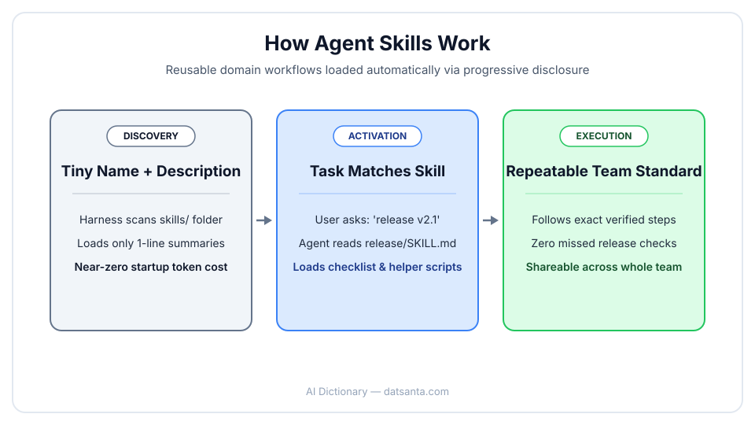

# Skill (Agent Skill)

An **agent skill** is a reusable folder of domain instructions, templates, and helper scripts that a coding [harness](harness.md) discovers automatically and loads on demand whenever a user's task matches that skill's description.

## Everyday example

Think of a chef's recipe binder sitting neatly on a shelf: the chef does not memorize every holiday dessert recipe every morning, but the moment a customer orders crème brûlée, they pull out that exact one-page card with exact temperatures and steps. Skills apply [progressive disclosure](progressive-disclosure.md) to AI agents—letting teams package workflows like `"deploy-release"` or `"write-migration"` without cluttering every unrelated chat.

## Don't confuse with

- **[MCP (Model Context Protocol)](mcp.md):** MCP connects an agent to live external APIs and data servers; a skill packages local instructions, checklists, and scripts teaching the agent *how* to perform a workflow.

## Related terms

- [Progressive Disclosure](progressive-disclosure.md)
- [AGENTS.md](agents-md.md)
- [Harness](harness.md)
