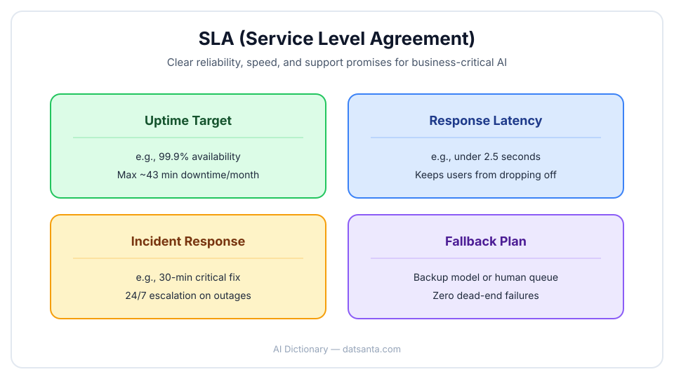

# SLA (Service Level Agreement)

An **SLA** is a formal contract promise from an AI vendor guaranteeing uptime (such as `99.9%` availability), maximum response speed, and support response times — with credits or penalties if they fail.

## Everyday example

If your customer-facing support bot relies on an external AI API and that API goes down for 4 hours on Black Friday, your business loses orders.

An SLA acts like a reliability guarantee from your power utility: enterprise plans promise 99.9% uptime and priority routing, whereas free or consumer plans offer zero uptime guarantees if servers overload.

## Don't confuse with

- **Accuracy guarantee:** An SLA guarantees the AI server is *online and fast*, not that the AI will never [hallucinate](hallucination.md) or give a wrong business answer.
- **[Data privacy](data-privacy.md) terms:** Privacy agreements cover how your data is stored and protected; SLAs cover uptime, speed, and outage support.

## Related terms

- [Vendor Lock-in](vendor-lock-in.md)
- [Build vs. Buy](build-vs-buy.md)
- [Latency vs. Throughput](latency-vs-throughput.md)
- [Rate Limiting](rate-limiting.md)
