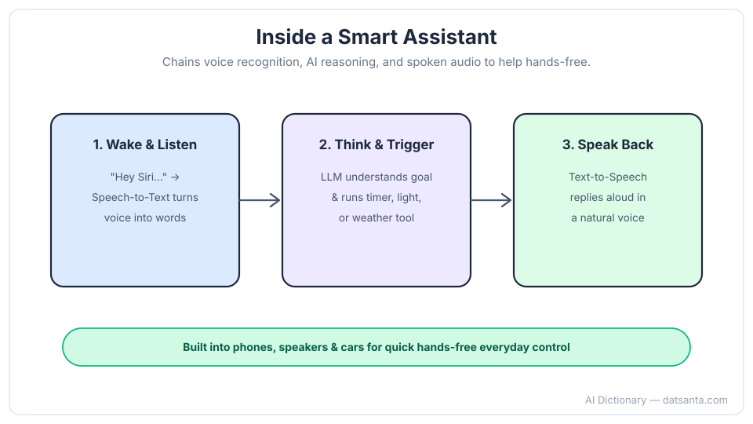

# Smart Assistant

A **smart assistant** (such as Siri, Google Assistant, or Alexa) is a voice- or text-activated software helper on your phone, speaker, or car that answers quick questions and controls everyday device tasks.

## Everyday example

Saying *"Hey Siri, set a 10-minute pasta timer and turn off the living room lights"* lets you get things done hands-free while cooking.

Older smart assistants could only match rigid pre-programmed commands and failed on slightly reworded questions. Modern smart assistants pair [speech-to-text](speech-to-text.md), [LLMs](llm.md), and [text-to-speech](text-to-speech.md) to hold natural conversations and handle multi-step requests.

## Don't confuse with

- **[Chatbot](chatbot.md):** A chatbot lives inside a browser or chat app for reading and writing; a smart assistant integrates with your phone's alarms, calls, smart-home lights, and voice wake-words.
- **Human assistant:** Smart assistants excel at reminders, weather, and quick lookups, yet still need clear confirmation before sending important messages or making purchases.

## Related terms

- [Speech-to-Text](speech-to-text.md)
- [Text-to-Speech](text-to-speech.md)
- [Chatbot](chatbot.md)
- [AI Agent](ai-agent.md)
