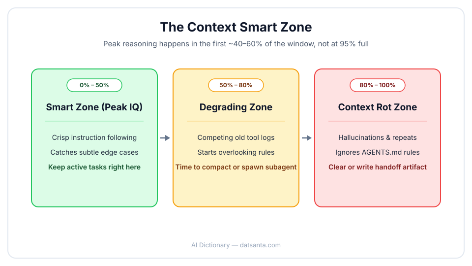

# Smart Zone

The **smart zone** is the sweet-spot portion of an LLM's [context window](context-window.md) (often the first 40–60% of capacity) where the model follows instructions sharply, catches subtle bugs, and reasons reliably before clutter degrades performance.

## Everyday example

A desk might technically hold 50 stacked folders before papers fall off the edge, yet you only do your best work when just 5 relevant folders are open in front of you. Even when a model advertises a 200k-token window, keeping active coding sessions inside the smart zone—by clearing finished tasks, using [subagents](subagent.md), or compacting early—keeps answers crisp instead of drifting into [context rot](context-rot.md).

## Don't confuse with

- **[Context Window](context-window.md):** Context window is the hard maximum token limit a model accepts; the smart zone is the much smaller practical range where quality stays near its peak.

## Related terms

- [Context Rot](context-rot.md)
- [Compaction](compaction.md)
- [Subagent](subagent.md)
