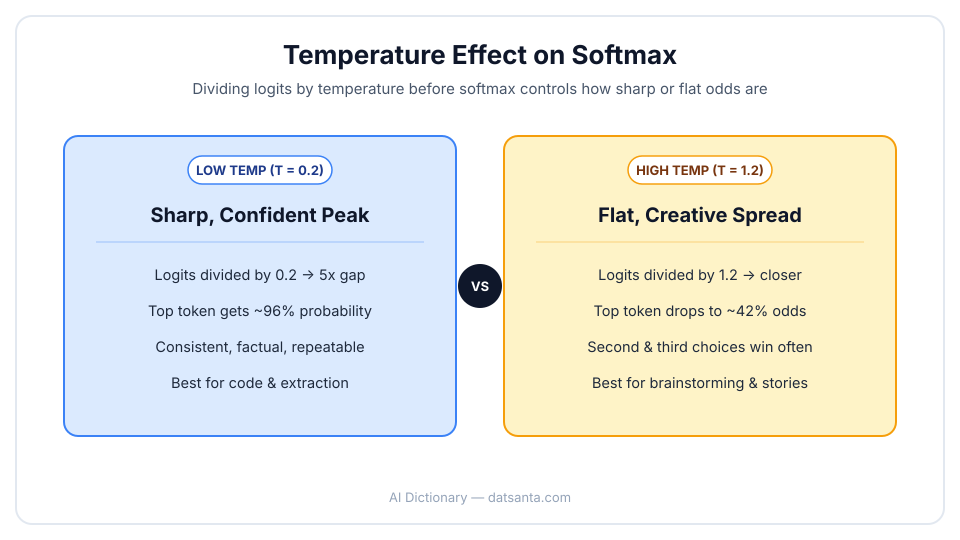

# Softmax

**Softmax** is the mathematical function that converts a list of raw [logits](logits.md) into a clean probability distribution where every value is positive and all values add up to `1.0` (`100%`).

## Everyday example

Suppose three delivery apps have raw user ratings of `4.8`, `4.2`, and `3.0`. Softmax exponentiates those scores so higher numbers stand out strongly, then divides by the total so you get shareable odds like `62%`, `31%`, and `7%`. In LLM decoding, [temperature](temperature.md) divides the logits *before* softmax: lower temperature sharpens the winner close to `100%`, while higher temperature flattens the odds.

## Don't confuse with

- **[Logits](logits.md):** Logits are the raw inputs going into softmax; softmax outputs normalized probabilities ready for sampling.

## Related terms

- [Logits](logits.md)
- [Temperature](temperature.md)
- [Top-p Sampling](top-p-sampling.md)
