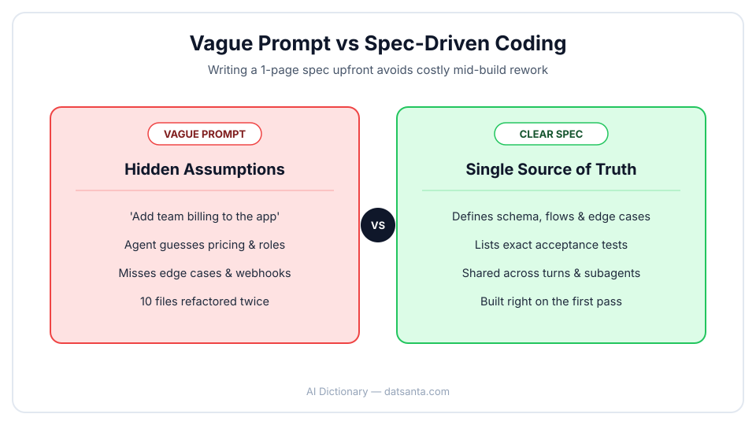

# Spec (AI Coding Specification)

A **spec** is a clear, written blueprint describing what a feature should do, its edge cases, data shapes, and acceptance tests—authored *before* asking a coding agent to write implementation code.

## Everyday example

Telling a house builder `"build me a nice kitchen"` guarantees expensive misunderstandings; handing them a one-page floor plan with measurements, outlets, and appliance cutouts gets it built right on the first pass. With AI coding agents, spending ten minutes writing a tight spec (often refined through [grilling](grilling.md)) prevents the model from inventing silent assumptions and lets it verify its own work cleanly.

## Don't confuse with

- **[Prompt](prompt.md):** A prompt is any ad-hoc message typed into chat; a spec is a durable, structured engineering document that serves as the single source of truth across multiple agent turns or sessions.

## Related terms

- [Grilling](grilling.md)
- [AFK Agent](afk-agent.md)
- [Planning Pattern](planning-pattern.md)
