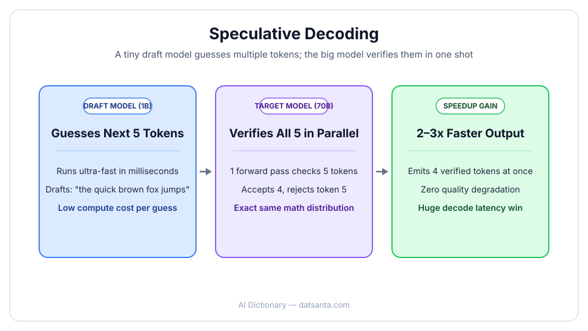

# Speculative Decoding

**Speculative decoding** speeds up LLM text generation by letting a tiny, ultra-fast draft model guess the next few tokens, then having the big target model verify all of them in a single parallel pass.

## Everyday example

Imagine a senior editor working with a fast junior typist. Instead of dictating one word at a time, the junior drafts the whole next sentence in half a second. The senior editor scans it in one glance, accepts the six correct words immediately, and only corrects word seven. You get the exact same mathematical output distribution as the big model, often 2–3x faster.

## Don't confuse with

- **[Model Routing](model-routing.md):** Model routing sends easy prompts to a small model and hard prompts to a big model; speculative decoding uses both models together on *every* turn without losing big-model quality.

## Related terms

- [TPS (Tokens per Second)](tps.md)
- [Prefill and Decode](prefill-and-decode.md)
- [Inference](inference.md)
