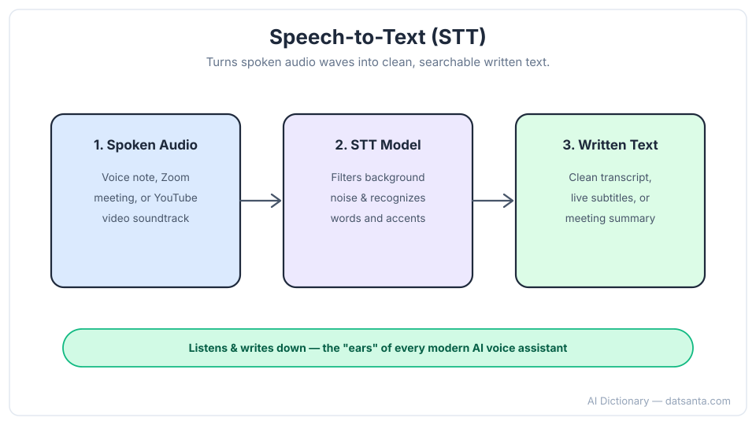

# Speech-to-Text (STT)

**Speech-to-text** (also called automatic speech recognition) is AI that listens to spoken audio and converts it into written text — powering meeting transcripts, voice typing, and live subtitles.

## Everyday example

When you tap the microphone icon on your phone to dictate a message, watch auto-generated YouTube captions, or record a Zoom call that turns into meeting notes, speech-to-text is doing the listening.

Modern STT models (like Whisper) handle accents, background café noise, and mixed languages remarkably well, outputting clean text that an [LLM](llm.md) can immediately summarize.

## Don't confuse with

- **[Text-to-speech](text-to-speech.md):** Speech-to-text turns *voice into written words* (listening); text-to-speech does the reverse, turning *written words into spoken audio* (speaking).
- **Voice assistant:** A full voice assistant chains speech-to-text (hear) → [LLM](llm.md) (think) → text-to-speech (reply aloud).

## Related terms

- [Text-to-Speech](text-to-speech.md)
- [Multimodal AI](multimodal-ai.md)
- [NLP](nlp.md)
