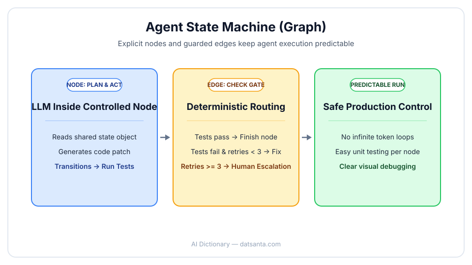

# State Machine (Agent Graph)

A **state machine** models an AI workflow as explicit nodes (steps) and edges (allowed transitions) over a shared state object—giving developers deterministic control over loops, retries, and human-approval pauses.

## Everyday example

A traffic intersection does not let lights switch randomly; it follows strict rules (`Green -> Yellow -> Red`) based on timers and sensors. Pure open-ended agent loops can wander or burn tokens forever. Modeling an agent as a state machine (e.g., `Plan -> Execute -> Test -> [Pass: Finish | Fail: Retry <= 3]`) keeps AI flexible inside each node while guaranteeing safe, predictable execution flow.

## Don't confuse with

- **[ReAct Pattern](react-pattern.md):** ReAct lets a single LLM freely decide every next action in an open loop; a state machine constrains which steps can follow which, making production agents far easier to test.

## Related terms

- [Checkpointing](checkpointing.md)
- [Orchestration](orchestration.md)
- [Circuit Breaker](circuit-breaker.md)
