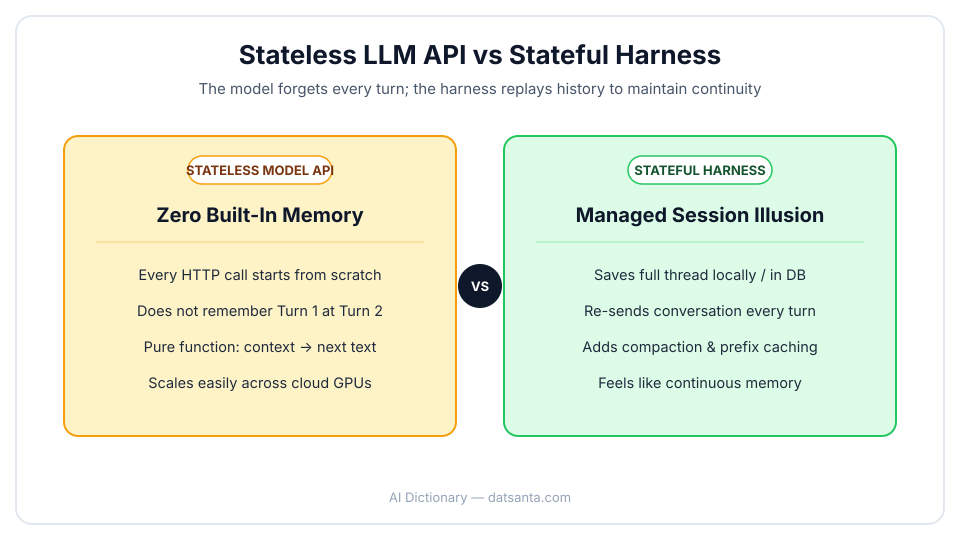

# Stateless vs. Stateful

LLM APIs are **stateless**—every request starts with zero memory of past turns—so the [harness](harness.md) creates the illusion of a **stateful** conversation by storing history locally and re-sending the whole thread on every turn.

## Everyday example

Talking to a stateless API is like calling a genius consultant who gets amnesia the second you hang up. Every time you call back with a new question, your assistant (the harness) reads out the transcript of everything you discussed earlier so the consultant stays caught up. That is why long chats grow slower and cost more input tokens on every single turn unless you [compact](compaction.md) or cache prefixes.

## Don't confuse with

- **[Agent Memory](agent-memory.md):** Agent memory persists long-term user preferences across *separate* sessions in a database; stateless vs. stateful explains why even a *single* chat session must re-send prior turns to the API.

## Related terms

- [Harness](harness.md)
- [Compaction](compaction.md)
- [Checkpointing](checkpointing.md)
