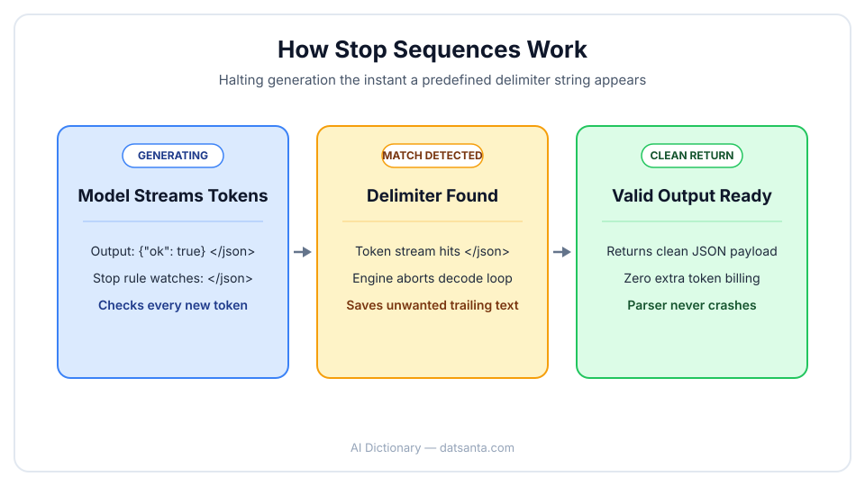

# Stop Sequence

A **stop sequence** is one or more specific characters or strings (such as `\nUser:` or `</json>`) that tell the inference engine to halt text generation immediately as soon as the model outputs them.

## Everyday example

In a walkie-talkie conversation, saying "Over" tells the other person to stop listening and start talking. Without a stop sequence in a custom prompt format, an LLM might answer your question and then keep going—inventing follow-up user questions and answering itself forever. Setting clean stop sequences saves wasted output tokens and keeps structured parsers from breaking.

## Don't confuse with

- **[Max Tokens](context-window.md):** Max tokens is a hard numeric ceiling on length regardless of meaning; a stop sequence ends generation cleanly when a specific delimiter appears.

## Related terms

- [Structured Outputs](structured-outputs.md)
- [Tokenization](tokenization.md)
- [Inference](inference.md)
