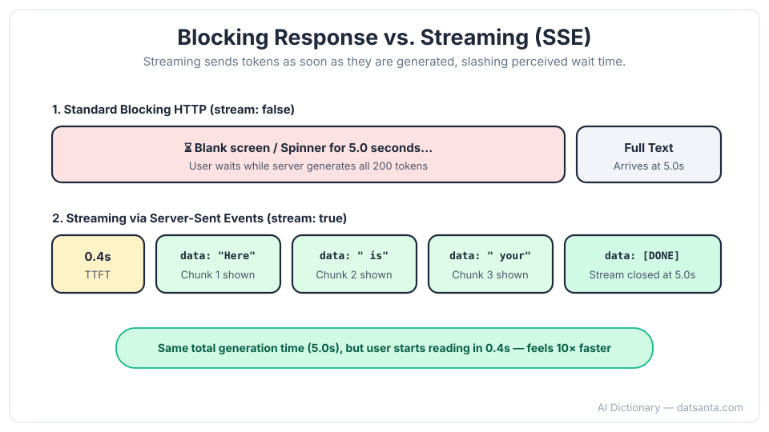

# Streaming (SSE)

**Streaming** sends an [LLM's](llm.md) output [tokens](token.md) to your app one small chunk at a time (usually via Server-Sent Events) as they are generated, instead of waiting for the entire reply to finish.

## Everyday example

Compare downloading a whole movie before watching a single frame versus streaming on Netflix. With a blocking HTTP call (`stream: false`), your user stares at a spinning loader for 5 seconds until all 200 tokens finish.

With `stream: true`, the first word appears in ~0.4 seconds (`TTFT`) and flows onto the screen live. Total generation time is identical, yet the app feels dramatically faster.

## Don't confuse with

- **WebSockets:** WebSockets open two-way persistent sockets; most LLM APIs use simpler one-way Server-Sent Events (`SSE` over HTTP) since only the server streams tokens back.
- **Lower total [latency](latency-vs-throughput.md):** Streaming improves *perceived* speed (`Time To First Token`), not total time until the final `[DONE]` event.

## Related terms

- [Latency vs. Throughput](latency-vs-throughput.md)
- [Inference](inference.md)
- [Token](token.md)
