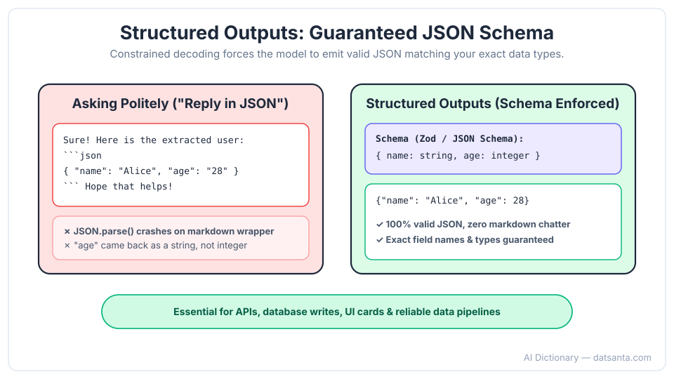

# Structured Outputs

**Structured outputs** force an [LLM](llm.md) to return data matching an exact schema (such as strict JSON with typed fields) instead of unpredictable free-form paragraphs.

## Everyday example

Politely asking a model *"Reply only in JSON"* is like asking someone to fill out a blank piece of paper — sooner or later they add `"Sure! Here's your JSON:"`, wrap it in markdown backticks, or return `"28"` as a string instead of an integer, crashing `JSON.parse()`.

Structured outputs use constrained decoding at the token-sampling layer: invalid syntax tokens are blocked from being picked at every step, guaranteeing 100% schema-valid JSON ready for your database or frontend UI.

## Don't confuse with

- **JSON mode (legacy):** Older JSON mode ensured *syntactically* valid JSON, but the model could still invent missing keys or wrong field types; schema-enforced structured outputs guarantee exact keys and types.
- **[Function calling](function-calling.md):** Function calling uses structured schemas to pick and invoke external tools; structured outputs format the final response itself.

## Related terms

- [Function Calling](function-calling.md)
- [Temperature](temperature.md)
- [Few-shot Prompting](few-shot-prompting.md)
