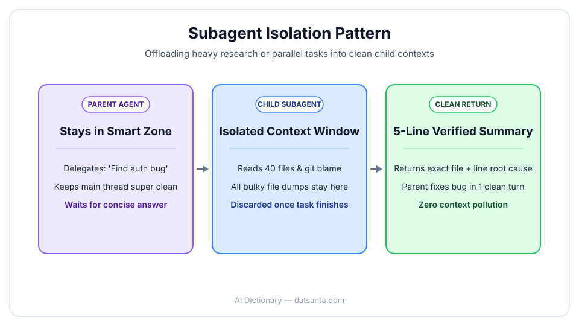

# Subagent

A **subagent** is a child AI agent spawned by a main coding agent inside its own isolated [context window](context-window.md) to handle a focused subtask—such as searching 40 files or reviewing a diff—and return only a clean summary.

## Everyday example

Imagine a lead architect asking a junior researcher to check 30 building codes in another room and come back with a five-line answer. The lead's desk stays spotless because all 30 bulky codebooks stay in the researcher's room. Spawning subagents keeps the main agent inside its [smart zone](smart-zone.md) and lets independent research or edits run in parallel.

## Don't confuse with

- **[Agent Handoff](handoff.md):** A handoff transfers the entire active user conversation to a new agent; a subagent runs in the background as a helper and reports its result back to the parent agent.

## Related terms

- [Multi-Agent System](multi-agent-system.md)
- [Smart Zone](smart-zone.md)
- [Harness](harness.md)
