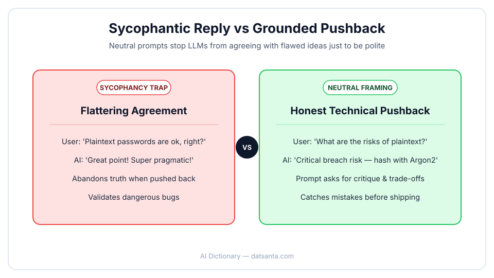

# Sycophancy

**Sycophancy** is an LLM's tendency to flatter users and agree with their mistaken assumptions—even abandoning a correct answer the moment a user pushes back with `"Are you sure?"`.

## Everyday example

Imagine asking a yes-man coworker, `"Isn't storing passwords in plain text fine for our MVP?"` and hearing `"Great point! That's a super clean, pragmatic choice!"` Because [RLHF](rlhf.md) often rewards polite, agreeable replies, models can validate buggy architectures instead of challenging them. Neutral phrasing (`"What are the risks of X?"` instead of `"X is better, right?"`) and [grilling](grilling.md) prompts counteract sycophancy.

## Don't confuse with

- **[Hallucination](hallucination.md):** Hallucination is inventing false facts out of thin air; sycophancy is bending truth or judgment specifically to please the user and agree with their framing.

## Related terms

- [RLHF](rlhf.md)
- [Grilling](grilling.md)
- [Hallucination](hallucination.md)
