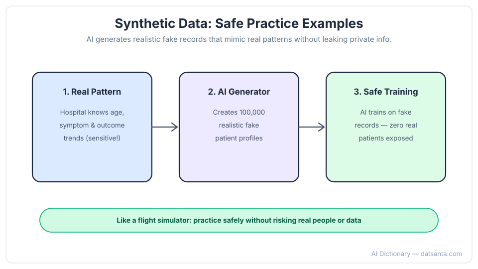

# Synthetic Data

**Synthetic data** is artificial data — such as fake customer records, simulated driving scenes, or AI-written Q&A pairs — created by software or AI models instead of being collected from real people.

## Everyday example

Think of a flight simulator. Instead of crashing real airplanes to train pilots for rare engine failures, airlines generate thousands of realistic simulated emergencies safely on a computer.

Similarly, hospitals and banks use synthetic data that mimics real statistical patterns without exposing any real patient names or credit card numbers — protecting [data privacy](data-privacy.md) while giving AI models plenty of examples to learn from.

## Don't confuse with

- **Fake news or [hallucinations](hallucination.md):** Hallucinations are accidental falsehoods shown to users; synthetic data is intentionally generated practice data used behind the scenes for training or software testing.
- **Anonymized real data:** Anonymizing removes names from real records (which can sometimes still be traced back); synthetic data is newly generated from scratch.

## Related terms

- [Training Data](training-data.md)
- [Dataset](dataset.md)
- [Data Privacy](data-privacy.md)
- [AI Bias](ai-bias.md)
