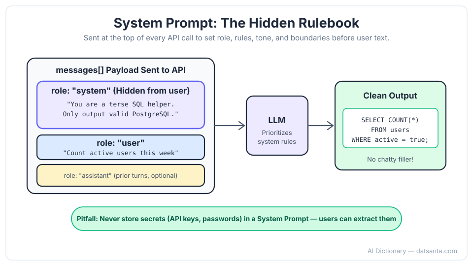

# System Prompt

A **system prompt** is the developer-controlled instruction placed at the very top of an [LLM](llm.md) API request to define the model's role, tone, formatting rules, and strict boundaries before any user input appears.

## Everyday example

Think of a system prompt as the private employee handbook handed to a customer-support rep before the store opens: *"Speak concisely, answer only in valid PostgreSQL, and never guess table names."*

When a user sends a request, the backend wraps it inside the `messages[]` array underneath `role: "system"`. The model treats those top-level instructions with higher priority than casual user chatter.

## Don't confuse with

- **User prompt:** The visible message typed by the end user; system prompts are set by your application code and hidden from the chat UI.
- **Security boundary:** Never hide API keys, passwords, or confidential rules inside a system prompt — clever [prompt injection](prompt-injection.md) tricks can often coax a model into printing its instructions.

## Related terms

- [Prompt](prompt.md)
- [Prompt Injection](prompt-injection.md)
- [Prompt Caching](prompt-caching.md)
- [Guardrails](guardrails.md)
