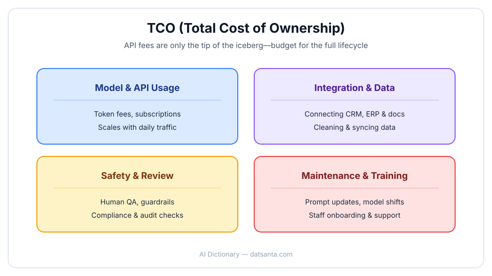

# TCO (Total Cost of Ownership)

**TCO** (Total Cost of Ownership) is the true all-in cost of running an AI solution over 1–3 years — combining software/API bills, setup engineering, data cleanup, staff training, and ongoing human review.

## Everyday example

Buying a $500 printer looks cheap until you count three years of ink cartridges, paper jams, and IT support time.

An AI project works the same way. A $200/month API bill is often only 20% of TCO — the remaining 80% hides in cleaning messy company documents for [RAG](rag.md), building [guardrails](guardrails.md), monitoring accuracy, and [human-in-the-loop](human-in-the-loop.md) review.

## Don't confuse with

- **API token price:** Checking only "$X per million tokens" misses engineering hours, hosting, [evals](evals.md), and maintenance.
- **[AI ROI](ai-roi.md):** TCO measures *total cost*; ROI compares the *value gained* against that TCO to show whether the project pays off.

## Related terms

- [AI ROI](ai-roi.md)
- [Build vs. Buy](build-vs-buy.md)
- [Cost per Task](cost-per-task.md)
- [Token Budget](token-budget.md)
