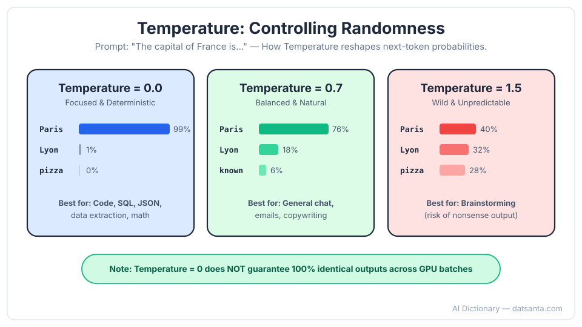

# Temperature

**Temperature** is an API parameter (typically `0.0` to `2.0`) that controls how random or deterministic an [LLM](llm.md) is when picking the next [token](token.md).

## Everyday example

Imagine spinning a weighted prize wheel where `"Paris"` covers 90% of the wheel and `"Lyon"` covers 10%. At `temperature = 0`, the model stops spinning and always picks the biggest slice (`"Paris"`).

Turn temperature up to `0.7` and smaller slices occasionally win, making phrasing feel natural. Crank it above `1.2` and the wheel flattens out — rare, bizarre words start winning, which quickly produces gibberish.

## Don't confuse with

- **[Top-p sampling](top-p-sampling.md):** Temperature reshapes the probability curve of *all* tokens; top-p trims off the unlikely tail candidates completely.
- **Factuality:** Setting `temperature = 0` makes outputs consistent, not necessarily truthful — a model can still repeat the same [hallucination](hallucination.md) reliably.

## Related terms

- [Top-p Sampling](top-p-sampling.md)
- [Structured Outputs](structured-outputs.md)
- [Token](token.md)
- [Hallucination](hallucination.md)
