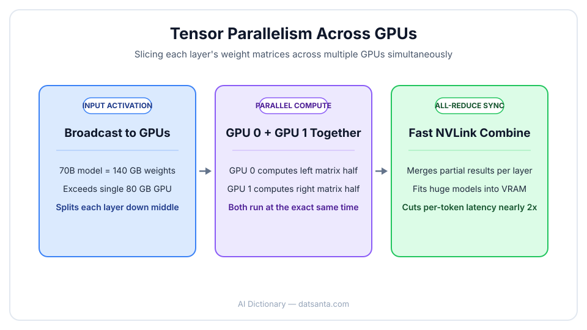

# Tensor Parallelism

**Tensor parallelism** splits individual weight matrices inside each neural-network layer across multiple GPUs so they compute every single token step together in parallel—needed when a model is too big or too slow for one GPU.

## Everyday example

Suppose a 70B model needs 140 GB of weights, while each GPU only has 80 GB of [VRAM](vram.md). Instead of putting Layer 1–40 on GPU A and sitting idle waiting for GPU B (pipeline parallelism), tensor parallelism slices each matrix down the middle so both GPUs crunch half of every layer simultaneously and sync over ultra-fast NVLink—cutting per-token latency nearly in half.

## Don't confuse with

- **[VRAM](vram.md):** VRAM is the physical high-speed memory capacity on each GPU chip; tensor parallelism is the multi-GPU sharding technique used when one GPU's VRAM or bandwidth is not enough.

## Related terms

- [VRAM](vram.md)
- [Inference](inference.md)
- [vLLM](vllm.md)
