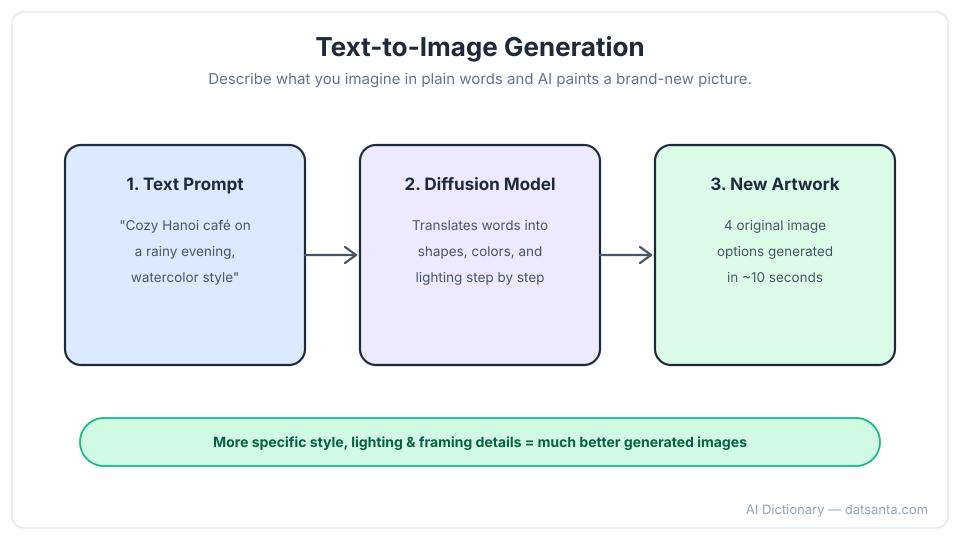

# Text-to-Image

**Text-to-image** is an AI tool that turns a written description ([prompt](prompt.md)) into a brand-new picture — whether a realistic photo, illustration, logo concept, or product mockup.

## Everyday example

Imagine describing a scene to a fast illustrator sitting across from you: *"A cozy wooden coffee shop in Hanoi on a rainy evening, warm yellow lighting, watercolor style."* Ten seconds later, you have four finished drafts to pick from.

Popular tools like Midjourney, DALL-E, Imagen, and Flux use [diffusion models](diffusion-model.md) under the hood to turn plain words into detailed artwork.

## Don't confuse with

- **Stock photo search:** Searching a stock site finds photos already taken by photographers; text-to-image generates a brand-new image that never existed before.
- **[Computer vision](computer-vision.md):** Computer vision reads a photo to describe what is in it (image-to-text); text-to-image goes in the opposite direction.

## Related terms

- [Diffusion Model](diffusion-model.md)
- [Generative AI](generative-ai.md)
- [Multimodal AI](multimodal-ai.md)
- [AI Watermark](ai-watermark.md)
