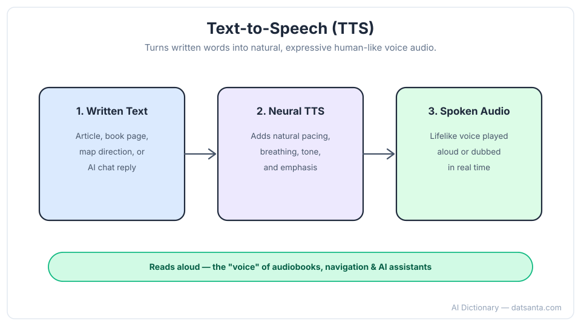

# Text-to-Speech (TTS)

**Text-to-speech** is AI that converts written text into spoken audio, reading articles, navigation directions, or [chatbot](chatbot.md) replies aloud in a natural human-like voice.

## Everyday example

Older text-to-speech sounded like a flat robot spelling out *"Turn. Left. In. Two. Hundred. Meters."*

Modern neural TTS captures natural breathing, pacing, emphasis, and emotion — letting apps read audiobooks aloud, dub videos into another language, or power lifelike voice assistants that respond in real time.

## Don't confuse with

- **[Speech-to-text](speech-to-text.md):** Text-to-speech *speaks* written text aloud; speech-to-text *listens* to speech and writes it down.
- **Voice cloning / [Deepfake](deepfake.md):** Standard TTS uses licensed studio voices; cloning a real person's voice without permission crosses into deepfake and fraud territory.

## Related terms

- [Speech-to-Text](speech-to-text.md)
- [Multimodal AI](multimodal-ai.md)
- [Deepfake](deepfake.md)
