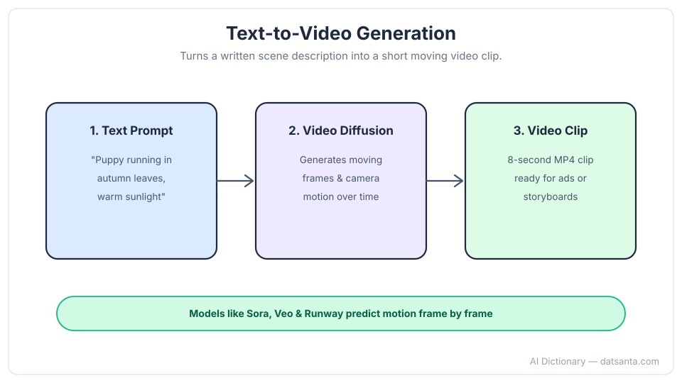

# Text-to-Video

**Text-to-video** is an AI tool that creates short video clips — complete with moving scenes, lighting, and camera motion — directly from a written description ([prompt](prompt.md)).

## Everyday example

Imagine typing *"A golden retriever puppy running through autumn leaves in slow motion, warm afternoon sunlight"* and getting a realistic 8-second video clip a minute later without picking up a camera.

Tools like Sora, Veo, Runway, and Kling use advanced [diffusion models](diffusion-model.md) to predict how objects move across frames, making them handy for storyboards, ads, and quick visual demos.

## Don't confuse with

- **[Text-to-image](text-to-image.md):** Text-to-image creates a single still picture; text-to-video generates a sequence of moving frames over time.
- **Video editing AI:** Auto-captioning or trimming an existing recording edits real footage; text-to-video invents the entire scene from scratch.

## Related terms

- [Text-to-Image](text-to-image.md)
- [Diffusion Model](diffusion-model.md)
- [Deepfake](deepfake.md)
- [AI Watermark](ai-watermark.md)
