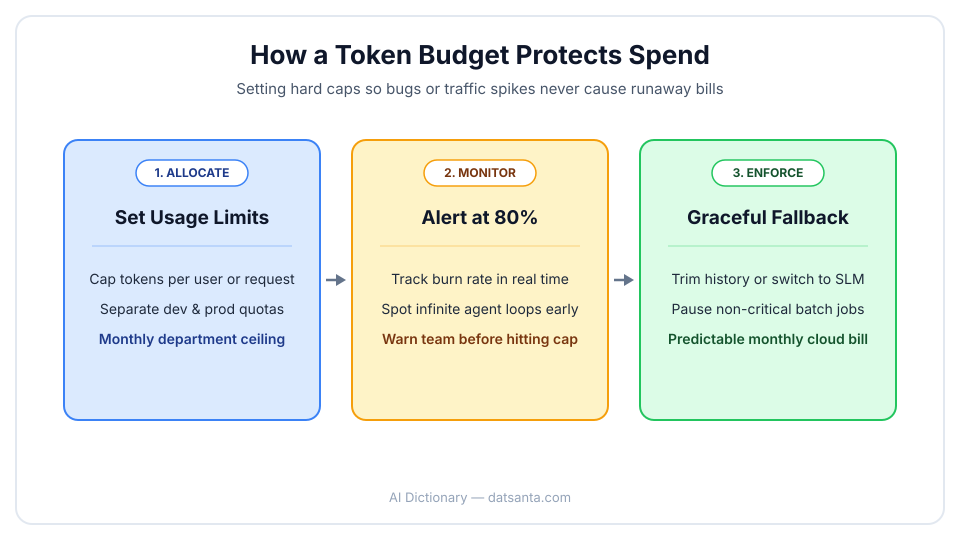

# Token Budget

A **token budget** is a spending or usage cap that limits how much text an AI feature, team, or customer can process within a set period—such as per request, per day, or per month.

## Everyday example

Think of a prepaid corporate fuel card with a $500 monthly limit per truck. Drivers can do their routes freely, but no single trip or runaway detour can drain the company bank account overnight. A token budget works the same way for AI APIs: it prevents a buggy loop, an oversized document upload, or sudden traffic spike from turning into a surprise five-figure cloud bill.

## Don't confuse with

- **[Cost per Task](cost-per-task.md):** Cost per task measures what one job costs; a token budget is the hard ceiling that stops total usage from overspending.

## Related terms

- [Token](token.md)
- [TCO](tco.md)
- [Service Tiering](service-tiering.md)
