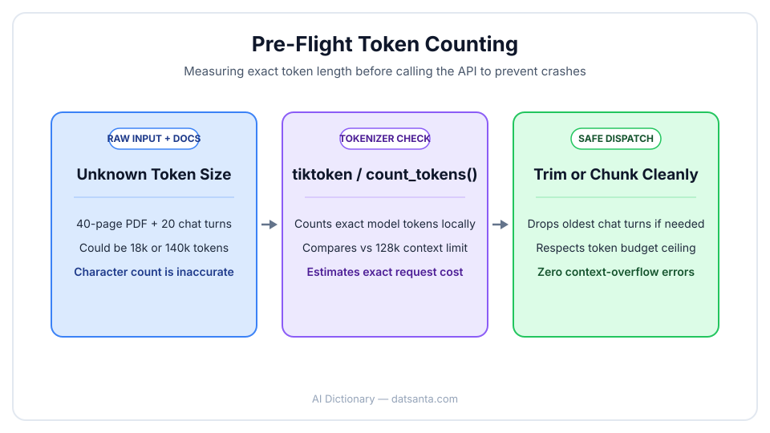

# Token Counting

**Token counting** measures the exact number of tokens in a prompt, document chunk, or conversation history *before* calling an LLM API so your app stays inside the [context window](context-window.md) and enforces [token budgets](token-budget.md).

## Everyday example

A shipping clerk weighs every parcel on a scale before putting it in the delivery van rather than guessing by eye and getting turned away at the dock. Using the provider's tokenizer (like `tiktoken` or a `/count_tokens` endpoint), your backend knows whether a 40-page PDF is `18,400` tokens or `140,000` tokens—letting you trim history cleanly instead of crashing mid-request.

## Don't confuse with

- **[Tokenization](tokenization.md):** Tokenization is the full process of splitting text into token IDs for model input/output; token counting specifically calculates the total length upfront for truncation, chunking, and billing estimates.

## Related terms

- [Tokenization](tokenization.md)
- [Token Budget](token-budget.md)
- [Context Window](context-window.md)
